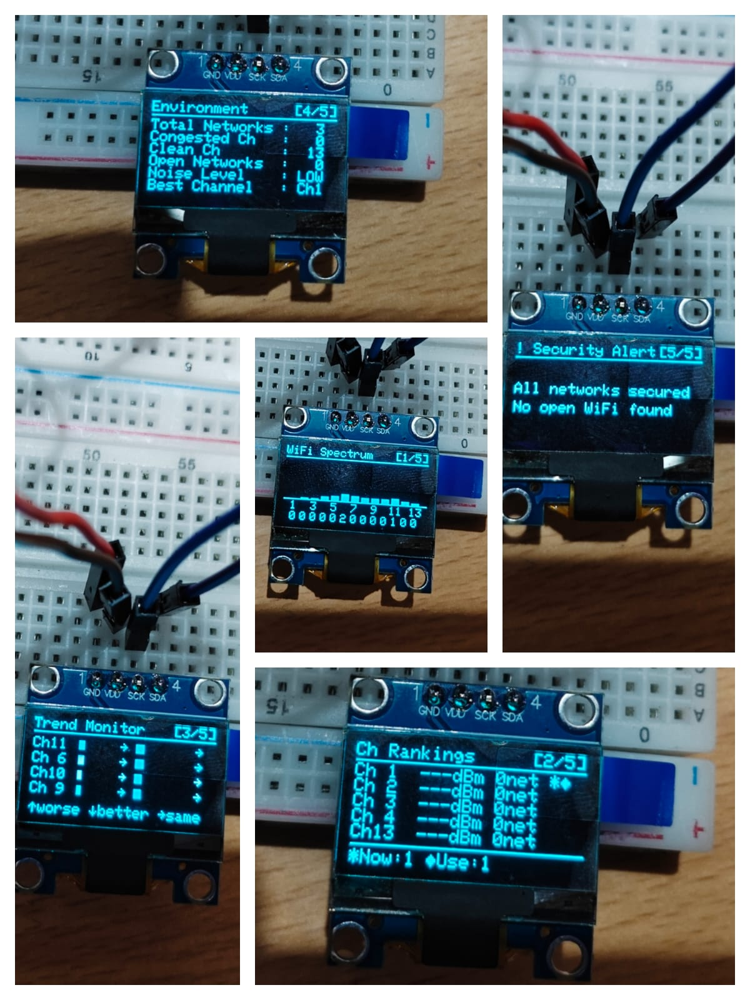
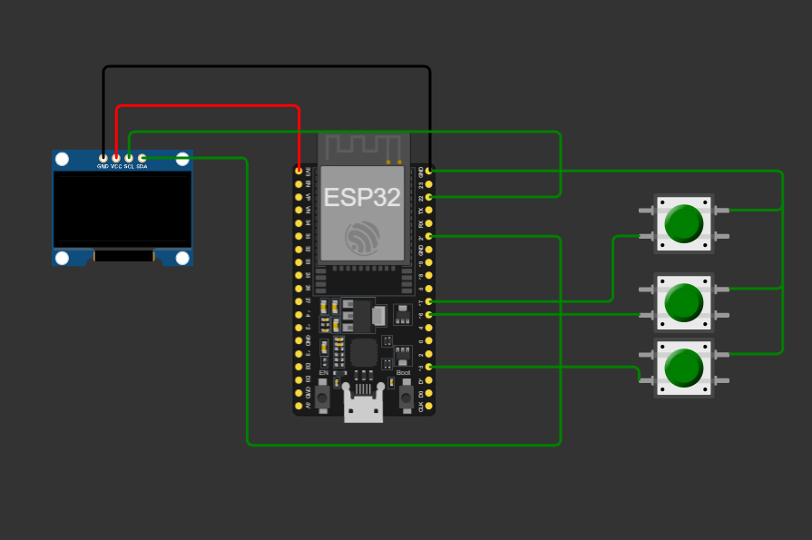

# SpectraNode - ESP32 WiFi Channel Monitor & Interference Detector

I built this pocket-sized 2.4 GHz WiFi channel monitor on an ESP32 for around ₹300 in parts. Hostel WiFi crawls every night around 8 pm, and I wanted to see why without buying an expensive RF analyzer. It scans all 13 channels, checks how much interference is bleeding over from nearby routers, and shows everything live on a tiny OLED.

Made during my Summer Training & Internship Program (BET-S559) at Gurukula Kangri (Deemed to be University).

---

## What it does (5 OLED screens)

You can switch between 5 screens using the 3 push buttons on the breadboard:

1. WiFi Spectrum [1/5] - Bar graph showing the load on every channel from 1 to 13, with the number of networks printed underneath.
2. Channel Rankings [2/5] - Top 5 cleanest channels sorted by signal strength (RSSI) and interference score. Marks Best Now (*) and Best Long-Term (diamond).
3. Trend Monitor [3/5] - Compares the current scan against the average of the last 5 scans so you can see if a channel is getting worse, better, or staying the same.
4. Environment [4/5] - Quick summary of total networks around you, how many channels are congested vs clean, overall noise level (LOW, MED, or HIGH), and the best channel to use.
5. Security Alert [5/5] - Lists any open (unsecured) WiFi networks nearby along with their SSID and channel so you know what to avoid.

---

## How the interference math works

Just counting how many routers are on a channel isn't enough. In the 2.4 GHz band, channels overlap—so a channel can look completely empty and still have terrible speed because of traffic bleeding in from its neighbours.

To fix this, SpectraNode turns each network's RSSI into a positive weight (RSSI minus the -100 dBm noise floor) and adds bleed-over from adjacent channels up to 4 channels away:

- Same channel (0 away): 100% weight (1.0)
- 1 channel away: 70% bleed (0.7)
- 2 channels away: 50% bleed (0.5)
- 3 channels away: 30% bleed (0.3)
- 4 channels away: 10% bleed (0.1)

Based on these scores, it gives two different recommendations:
- Best Right Now: The cleanest channel out of all 13 at this exact moment.
- Best Long-Term: The best pick strictly from channels 1, 6, and 11 (the only non-overlapping channels), which is what you should actually set a router to.

---

## Wiring

| OLED / Button Pin | ESP32 Pin | Notes |
| :--- | :--- | :--- |
| OLED VCC | 3.3V | Power |
| OLED GND | GND | Ground |
| OLED SDA | GPIO 21 | I2C Data |
| OLED SCL | GPIO 22 | I2C Clock |
| Button 1 (Refresh) | GPIO 15 | Other leg to GND (uses internal pullup) |
| Button 2 (Next) | GPIO 16 | Other leg to GND (uses internal pullup) |
| Button 3 (Back) | GPIO 17 | Other leg to GND (uses internal pullup) |

---

## How to run it

1. Open Arduino IDE and make sure you have the "esp32" board package by Espressif Systems installed.
2. Go to Library Manager and install:
   - Adafruit SSD1306
   - Adafruit GFX Library
   - Adafruit BusIO
3. Open `firmware/SpectraNode.ino`, select "ESP32 Dev Module", and hit Upload.
4. (Optional) Open Serial Monitor at 115200 baud if you also want to see the full channel-by-channel scan logs on your PC.

